<!-- Profile README for github.com/robertgeraldsenasin. The pictures switch with GitHub's light or dark theme. -->
<picture>
  <source media="(prefers-color-scheme: dark)" srcset="assets/header-dark.svg">
  <source media="(prefers-color-scheme: light)" srcset="assets/header-light.svg">
  
</picture>

Final-year Computer Science student at **FEU Institute of Technology**, working across software, applied AI and games. I led the team behind our thesis, **M.I.N.E.R.V.A.**, awarded back to back at the FEU Tech Student Research Colloquium and CS Expo 2026.

**[Portfolio](https://robertgeraldsenasin.github.io)** &nbsp;/&nbsp; **[LinkedIn](https://www.linkedin.com/in/rga-senasin)** &nbsp;/&nbsp; **[Email](mailto:robertgeraldsenasin@gmail.com)**

## Case files

<a href="https://github.com/robertgeraldsenasin/MINERVA"><picture>
  <source media="(prefers-color-scheme: dark)" srcset="assets/case-minerva-dark.png">
  <source media="(prefers-color-scheme: light)" srcset="assets/case-minerva-light.png">
  
</picture></a>

The Tagalog rumor-detection pipeline behind our thesis game: RoBERTa-Tagalog and DistilBERT detectors, a dual-embedding graph neural network, a QLattice scoring equation, and GPT-2 posts curated into card decks for a Unity Android game. 
Thesis, 2026 &nbsp;·&nbsp; team lead and lead developer &nbsp;·&nbsp; 2nd Place Best Paper, then Most Innovative (3rd Place) at CS Expo 2026 &nbsp;·&nbsp; **[Open the repo →](https://github.com/robertgeraldsenasin/MINERVA)**

<a href="https://github.com/robertgeraldsenasin/ProgLang_ErrorPropagation"><picture>
  <source media="(prefers-color-scheme: dark)" srcset="assets/case-text-to-sql-dark.png">
  <source media="(prefers-color-scheme: light)" srcset="assets/case-text-to-sql-light.png">
  
</picture></a>

We logged 240 turns of four LLMs repairing SQL on Spider2-Lite with nothing but pass/fail feedback. None of the 48 runs reached a correct query; wrong results dominated, and some fixes made things worse. 
Research paper, 2026 &nbsp;·&nbsp; lead researcher and lead developer &nbsp;·&nbsp; submitted to IJACSA with Adrian Joseph Salva, in collaboration with Dr. Alexander Hernandez &nbsp;·&nbsp; **[Open the repo →](https://github.com/robertgeraldsenasin/ProgLang_ErrorPropagation)**

<a href="https://github.com/robertgeraldsenasin/hasik"><picture>
  <source media="(prefers-color-scheme: dark)" srcset="assets/case-hasik-dark.png">
  <source media="(prefers-color-scheme: light)" srcset="assets/case-hasik-light.png">
  
</picture></a>

Sungka, the Filipino mancala game, with Random, Greedy, Minimax and Monte Carlo Tree Search bots. They play paired games in an arena, Glicko-2 ranks them, and a sequential test rejects any change that makes the engine weaker. 
Personal project, 2026 &nbsp;·&nbsp; public, with move previews and a hint mode in the browser &nbsp;·&nbsp; **[Play it →](https://robertgeraldsenasin.github.io/hasik/)** &nbsp;·&nbsp; **[Open the repo →](https://github.com/robertgeraldsenasin/hasik)**

<a href="https://github.com/robertgeraldsenasin/robertgeraldsenasin.github.io"><picture>
  <source media="(prefers-color-scheme: dark)" srcset="assets/case-portfolio-dark.png">
  <source media="(prefers-color-scheme: light)" srcset="assets/case-portfolio-light.png">
  
</picture></a>

My portfolio, built as one HTML file with no framework: self-hosted fonts, motion that respects reduced-motion settings, and zero axe accessibility violations in both themes. 
HTML, CSS and JavaScript &nbsp;·&nbsp; deployed to GitHub Pages with GitHub Actions &nbsp;·&nbsp; **[Open the repo →](https://github.com/robertgeraldsenasin/robertgeraldsenasin.github.io)**

## Queued

- **Byahe: Metro Manila Live Dispatch** &nbsp;·&nbsp; Nov 20-23 &nbsp;·&nbsp; a delivery dispatch simulator on the real Metro Manila road network, with Contraction Hierarchies for routing and Adaptive Large Neighborhood Search for vehicle routes.
- **Bantay** (working title) &nbsp;·&nbsp; Nov – Dec &nbsp;·&nbsp; a procedural action roguelike set in Philippine mythology, built in Unity 6 with a teammate.

## Toolbox

| Lane | Tools |
| :--- | :--- |
| **Software** | Python, Java, C#, C++, JavaScript, SQL, HTML/CSS &nbsp;·&nbsp; FastAPI, React, Docker, Vercel &nbsp;·&nbsp; SAP CAP and BTP |
| **AI and data** | Hugging Face Transformers, GraphSAGE, QLattice, GPT-2, LLM evaluation &nbsp;·&nbsp; Neo4j (Cypher), MySQL, Oracle SQL, MongoDB, SQLite |
| **Games and mobile** | Unity 6 &nbsp;·&nbsp; Android Studio (Java) &nbsp;·&nbsp; Godot |
| **Workflow** | Git, GitHub, Claude Code |

**Certified:** SAP Certified Backend Developer (CAP) &nbsp;·&nbsp; SAP Certified Generative AI Developer &nbsp;·&nbsp; Neo4j Certified Professional &nbsp;·&nbsp; IT Specialist: Python

## Now

- Hasik is public: **[play it in your browser](https://robertgeraldsenasin.github.io/hasik/)** or **[read the code](https://github.com/robertgeraldsenasin/hasik)**.
- Taking the GitHub Foundations exam this month.
